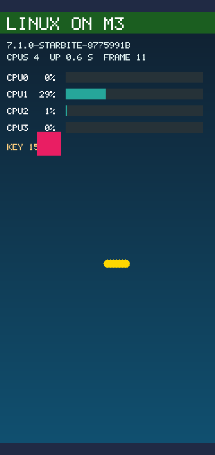

# Starbite OS 0.9: Linux apps on the M3 cluster (design + host prototype, 2026-11-08)

Starbite OS keeps the four A55 cores; a Linux kernel runs alone on the four Mongoose M3 cores next to it, and
Linux apps draw into a surface that Starbite OS composites. There is no hypervisor: Starbite OS runs at EL1 and
Samsung's uH/RKP owns EL2 (docs/STARBITE-OS-1.0.md "EL2"). So this is asymmetric multiprocessing: two kernels at
EL1 with split memory, split CPUs, a split interrupt controller and a shared-memory contract. **There is no
isolation**: a broken guest can overwrite Starbite OS's memory. It is a research build until that changes.

Code: `starbite/guest/` (all new, owned by this work).

| File | What |
|---|---|
| `sbshm.h` | the contract: memory profiles (S9, QEMU), header, rings, ramoops zone, entry trampoline |
| `host/sbghost.{h,c}` | Starbite OS's side as an OS-independent core with a shim (like the Wi-Fi core) |
| `mk-guest-dts.py` | the guest's device tree (`--profile s9` or `qemu`) |
| `linux/sbguest.c` | guest kernel module: power off without SYSTEM_OFF, `/dev/sbshm` (mmap + doorbells) |
| `linux/mk-gic-patch.py`, `linux/0001-…patch`, `linux/build-patched.sh` | the GIC shared-distributor patch |
| `guestd/guestd.c` | guest user space: maps the region, draws the demo app, uinput, stop |
| `initramfs/init` | the guest's init (busybox) |
| `sbsim/` | Starbite OS's stand-in on QEMU; `run-qemu.sh` builds everything and runs the scenarios |
| `probe/` | phone payloads on libsb: P1 (carve-out, doorbell lines, the M3 stub on all four cores), P2 (Linux on the M3s) |

## 1. What is proven, what is not

| Claim | Status |
|---|---|
| The S9's own Linux 7.1 Image (unchanged) boots on CPUs 4..7 next to a running "Starbite OS" on CPU 0, from a CPU_ON through the trampoline, sees only its 4 CPUs and its RAM | **QEMU, 2/2 boots, twice** (HELLO 2.1 s idle VM, 9–10 s under load) |
| Shared surface: the guest renders, Starbite composites between its own bars | **QEMU** (docs/starbite-os-linux-m3-qemu.png) |
| Touch and keys forwarded: ring → guestd → uinput, the touch mark lands in the app's pixels | **QEMU** (pixel 0xffd700 at the tap) |
| Doorbells both ways through software-pended SPIs | **QEMU** (12 out, 6 back per two runs) |
| Guest power off = every guest CPU in PSCI CPU_OFF, host keeps running, cold restart works | **QEMU** (cluster off 170–470 ms after MSG_STOP, 2 boots in a row) |
| The stock GIC driver takes Starbite's lines (GICD_CTLR 0, every SPI disabled and retargeted to the guest) | **QEMU, measured** (`ITARGETSR 0x10`, sbsim's own line lost) |
| The interim fix: Starbite re-asserts its lines from its tick | **QEMU** (lines taken 4, re-asserted 4, 0 interrupts lost) |
| The real fix: `starbite,shared-distributor` patch (22 lines) | **QEMU, strict, 2/2 boots**: the S9 Image built with it leaves the distributor alone; host lines taken 0, own line lost 0 |
| The probe's M3 stub (x0, interface bit, WFI wake on the doorbell, host doorbell, CPU_OFF) | **QEMU, 4/4 CPUs**; phone: P1 staged (10) |
| Anything on the phone | **not yet**: P1 → P2 → P3 (10) |

## 2. Starting the M3 cluster with Linux

1. Starbite OS (from the store on UFS, like any payload) copies the guest's Image to `0x8_8000_0000 + text_offset`
   (the S9 port keeps `text_offset = 0x80000`), the DTB to `+128 MiB`, the initrd to `+130 MiB`, zeroes the
   shared header, rings and log zone and writes the header (`sbg_load`).
2. The M3 vendor PMU defaults (`sb_m3_pmu_defaults`: the six fields the daily Linux already writes with
   `s9p_vendor_m3_defaults`, xnu patch 0304), once per cluster power-up.
3. PSCI `CPU_ON(0x100, trampoline, dtb)`. The trampoline (`sbg_tramp`, 10 words in the shared header page) sets
   x0 = the DTB and x1..x3 = 0 and branches to the Image: the arm64 boot protocol, without relying on the
   firmware passing the context id (libsb only *checks* that, `sb_smp_own_record`; P1 measures it).
4. Linux brings up 0x101..0x103 itself with PSCI 0.1 `cpu_on` from its DT. The guest's DT is not
   `samsung,exynos9810`, so the S9 port's per-core PMU writes stay off.

Why this should work on the M3s: the mainline Linux on this phone already runs on the M3 cores from the same
loader path (EL1, SMC to EL3's PSCI, WFI idle), and Starbite OS's heater runs code there. What is new is the M3
as Linux's *boot* CPU. The Windows hand-off research (docs/WIN11-BIGCORES-RESEARCH.md 1.4) warns that EL3's
warm-boot EL2 defaults on the M3 are unmeasured. That is why P1 runs WFI, GIC CPU-interface and timer
accesses on each M3 from a stub before any Linux.

## 3. Memory

| Physical | Owner | Guest DT |
|---|---|---|
| `0x8_0000_0000` low banks (0x8000_0000..0xFF7F_FFFF) | Starbite OS, S-Boot, secure world, framebuffer | not listed |
| `0x8_8000_0000` .. `0x8_DFFF_FFFF` (1.5 GiB) | the guest's RAM | `/memory` |
| `0x8_E000_0000` .. `0x8_E3FF_FFFF` (64 MiB) | shared region | `/memory` + three `reserved-memory` nodes (no `no-map`) |
| `0x8_E400_0000` .. `0x8_FFFF_FFFF` | Starbite OS (Mali tables at `0x8_F000_0000`) | not listed |

The high bank is System RAM in TWRP's /proc/iomem with no DT reservation in it, and the mainline Linux uses
it. libsb already maps the whole bank non-cacheable (mmu.c), so Starbite OS writes the Image straight to DRAM
and reads the shared region without cache maintenance.

The shared region lies inside the guest's `/memory`, reserved without `no-map`. This is deliberate: arm64
`/dev/mem` maps RAM pages with `O_SYNC` as write-combine (Normal NC). A no-map region would come back as
Device-nGnRnE, where unaligned accesses and `dc zva` (glibc's memset) fault. The kernel module maps it with
`vmap(..., pgprot_writecombine)`, because `ioremap` refuses RAM on arm64. Both sides are non-cacheable on the
region, so nothing depends on the A55 and M3 clusters being coherent.

Layout of the region (`sbshm.h`): header page with the trampoline at +0xF00; host→guest ring at +0x1000;
guest→host ring at +0x3000 (SPSC, 128 × 32-byte messages); the guest's pstore/ramoops console at +0x100000
(512 KiB: the guest's kernel log, readable by Starbite OS at any time, even after a guest crash); two surfaces
from +0x200000.

## 4. Interrupts (the GIC-400)

Each CPU interface and each SGI/PPI is banked, so the generic timer (PPI 27, the virtual timer, used by both
kernels at EL1) needs no sharing rules. The distributor's SPI registers are global. The rules:

- **Starbite OS owns the distributor.** It resets it at boot, as today, and owns GICD_CTLR.
- **Byte and write-1 registers only while both run.** ITARGETSR and IPRIORITYR are written byte-wise;
  ISENABLER, ICENABLER, ISPENDR and ICPENDR are write-1-to-set/clear, so they are atomic. Starbite OS's
  `hw_spi` read-modify-writes the ITARGETSR *word* today (kern/hw.c). That must become a byte write (P3), or a
  concurrent guest affinity change on one of the other three lines in the word can be lost.
- **ICFGR words are shared by 16 lines and can only be read-modify-written.** Starbite OS configures every line
  the guest will use (edge for the doorbells) *before* CPU_ON and does not touch ICFGR while the guest runs.
  Linux's `gic_configure_irq` skips the write when the value already matches.
- **SPI ownership**: the guest's DT lists only its own lines (today the host→guest doorbell); Linux routes and
  enables what it requests with byte writes and write-1 registers.
- **SGIs**: Linux sends IPIs with GICD_SGIR to its own CPU map only. Starbite OS uses none.

**The hazard (measured):** the stock `gic_dist_init` writes GICD_CTLR = 0, disables every SPI and targets every
SPI at the guest's boot CPU. On QEMU, sbsim's own line was taken: `enabled 0, ITARGETSR byte 0x10 (mine 0x1)`.
On the phone that would be Starbite OS's Wi-Fi line (SPI 253) and every line it adds later.

- **Fix**, `linux/0001-irqchip-gic-starbite-shared-distributor.patch` (22 lines, generated by
  `mk-gic-patch.py`). With the DT property `starbite,shared-distributor`, `gic_dist_init` leaves the
  distributor as found, and `gic_dist_save/restore` (cluster power-down) do nothing. Per-CPU setup is
  unchanged. Without the property the driver behaves exactly as upstream, so the same Image still boots the S9
  as the main OS.
- **Interim** (stock kernel): `sbghost` checks every host line and GICD_CTLR on each tick and re-asserts them
  (`cfg.repair`). It is enough for tests (no interrupt was lost on QEMU), but an edge interrupt can still be
  lost inside the window.

**Doorbells** are two SPIs that no device drives, set pending in software through GICD_ISPENDR (edge): one to
the guest's boot CPU, one to Starbite OS's interface. QEMU uses INTIDs 132/133. On the phone the lines must be
idle, non-secure (Group 1: ISENABLER reads back) and must actually arrive. P1 tests candidates from the top of
the range that are not in the S9 DT (used: 38..99, 141, 176..179, 199..202, 214, 215, 220, 274..276, 281, 282,
285, 313..315, 428, 436, 453, 497).

## 5. Display

- The guest renders XRGB8888 into the back buffer of two, then `surf_front = back`, `dmb`, `surf_seq++` (and a
  damage rectangle). Starbite OS copies the front buffer when `surf_seq` changes (`sbg_frame`).
- In Starbite OS this is one more UI element kind, as planned in docs/STARBITE-OS-1.0.md: a rectangle copied
  from the shared buffer on each `ui_present`, plus a full-screen app mode with Starbite OS's status and
  navigation bars around it. On the phone the surface is 720×1440, shown at 2× (1440×2880) between the bars;
  1440×2960 at 1× fits too (2 × 17 MiB < 62 MiB).
- The prototype's app is `guestd` itself. It draws straight to the buffer and shows per-CPU load for the four
  M3 cores, a key line and the touch marks. Next steps for real apps: (a) `simpledrm` on the surface (needs
  `CONFIG_DRM_SIMPLEDRM`, off in the S9 config) so any DRM/fbdev client works unmodified, then (b) a small
  Wayland compositor in the guest that exports damage, or virtio-gpu over this transport for flush/damage
  semantics.

## 6. Input

Starbite OS keeps the touch controller and keys (the pocket lock stays in front). While the guest surface has
focus, it forwards touches in surface coordinates (`SBG_MSG_TOUCH`: slot, down/move/up, x, y) and keys
(`SBG_MSG_KEY`: Linux key codes) in order on the host→guest ring, then rings the doorbell. guestd turns them into
a multitouch uinput device, "Starbite touch" (`INPUT_PROP_DIRECT`, 10 slots), plus Back, Home, Power and
volume. Any Linux toolkit sees an ordinary touchscreen. Focus and screen on/off are messages too (`FOCUS`,
`SCREEN`).

## 7. Power and life cycle

- **Off until needed.** The M3 cluster stays powered down while Starbite OS runs alone. The first heavy app
  starts the guest: load, then CPU_ON. The guest's boot time is the start cost; on QEMU HELLO came after
  2.1 s with an idle host.
- **Stop** (`sbg_stop` → `MSG_STOP`): guestd syncs and powers off. `sbguest.ko` takes every other CPU down
  through a reboot notifier (`remove_cpu`, i.e. PSCI CPU_OFF each), then a sys-off handler above PSCI's marks the
  header and calls CPU_OFF on the last CPU. Starbite OS sees the cluster off: AFFINITY_INFO on QEMU; on the
  phone the PMU cluster status (`sb_m3_on()`), because the S9's PSCI 0.1 lists no AFFINITY_INFO.
- **The guest must never reach SYSTEM_OFF or SYSTEM_RESET.** On the S9 the guest's PSCI node is the phone's own
  0.1 node (`cpu_on`, `cpu_off` only), so Linux has neither call at all: a guest `reboot` or panic halts the
  guest only. On QEMU (PSCI 1.0) `sbguest.ko`'s handlers outrank PSCI's. Without the module a guest power off
  ends the whole QEMU machine. A panic leaves the other guest CPUs parked, not off; `guest_state = PANIC`
  tells the host.
- **No forced off.** PSCI has no "turn that core off" for another core. A guest that hangs keeps the cluster on
  until the next reset, so Starbite OS reports it. Its own watchdog and heat stops keep working because they
  run on the A55s. Mitigation: Starbite OS can lower the M3 clock to its lowest ACPM level.
- **Clocks and heat**: the guest has no CMU, ACPM or DVFS (none in its DT). Starbite OS sets the M3 frequency
  through ACPM for it (a later `MSG_PERF` hint) and its heat stops cover the M3 sensor.
- **Later**: screen off → `MSG_SCREEN` (guestd stops rendering), then a freeze with CPU_SUSPEND cluster
  power-down states and the doorbell as the wake source. Needs the vendor `cpu_suspend` parameters.

## 8. What the guest must not touch (and how that is enforced)

| Thing | How |
|---|---|
| PSCI SYSTEM_OFF / SYSTEM_RESET | S9: absent from the guest's PSCI 0.1 node; QEMU: `sbguest.ko` handlers first |
| The S9 port's `s9p_acpm_init` (no DT node needed: it would power-cycle the touch LDOs through ACPM) | `initcall_blacklist=s9p_acpm_init` in the guest's bootargs (checked on QEMU: its line is gone) |
| Clocks, PMIC, ACPM, watchdog, UFS, panel, Wi-Fi | not in the guest's DT; the port's other initcalls look for their nodes or for `samsung,exynos9810` |
| The A55 cores | not in the guest's DT |
| Starbite OS's memory | **not enforced**: `/dev/mem` reaches everything (the S9 config has no STRICT_DEVMEM). A guest kernel config for this role should have `STRICT_DEVMEM` and use `/dev/sbshm` only. No IOMMU or stage-2 exists to stop the kernel itself. |

The right long-term guest kernel is its own config (`guest.config`: no S9 port drivers, simpledrm, STRICT_DEVMEM,
the GIC patch, sbguest built in), not the daily S9 Image with a blacklist.

## 9. Host prototype (QEMU)

`limactl shell starbite -- /Users/dev/project-starbite/starbite/guest/run-qemu.sh SCENARIO` builds sbsim,
guestd, sbguest.ko (against the S9 build tree), the initramfs, the DTB and a "store" blob. QEMU runs `virt,
gic-version=2`, 8 Cortex-A53, 2 GiB, PSCI over HVC. sbsim is the stand-in for Starbite OS: it runs on CPU 0
with the MMU off, polls the GIC as Starbite OS does, and drives the guest through the same `sbghost` core.

| Scenario | Guest | Expect | Result (2026-11-08) |
|---|---|---|---|
| `repair` | stock S9 Image + sbguest.ko, host re-asserts lines | PASS | **PASS**: 2/2 boots, touch ok, cluster off 389/465 ms, lines taken 4 re-asserted 4, own SPI lost 0 |
| `patched` + `PSCI01=1` | as `patched`, with the S9-style PSCI 0.1 node (listed ids, no SYSTEM_OFF) | PASS | **PASS**: secondaries via 0.1 `cpu_on`, cluster off 76/78 ms, HELLO 2.0/1.8 s (idle VM) |
| `stub` | none: the probe's M3 stub on CPUs 4..7 | PASS | **PASS**: x0 = context id (direct) / DTB literal (trampoline), cpuif 0x10..0x80, doorbell after 1 WFI, host doorbell back, off |
| `patched` | Image with the GIC patch + sbguest.ko, strict | PASS | **PASS**: 2/2 boots (HELLO 7.0 / 6.0 s under load), touch ok, cluster off 356/249 ms, host lines taken 0, own SPI lost 0, `GIC: shared distributor ... CTLR 0x1 left as found` |
| `mod` | stock + sbguest.ko, no repair | FAIL (the hazard) | (shown by `repair`'s log: lines taken) |
| `nomod` | stock, no module | FAIL (no clean off) | not run: on PSCI 1.0 a guest power off ends the machine |

Panel from the `repair` run (half size): Starbite's bars, the guest app, the drag's touch marks, the key line:

### 9.1 The patched kernel

`starbite/guest/linux/build-patched.sh` builds the S9 Image with the patch incrementally in a copy of the build
tree's `out/` (the shared tree's own Image is not touched; the source carries the patch only during the build,
then it is reverted and checked pristine). 14 min on the VM's 8 cores (a near full rebuild in the copy), Image
`3c6f4547…` (7.1.0-starbite-8775991b, so sbguest.ko built against the tree loads). Without the DT property the
driver is upstream's, so this Image can replace the daily one once the phone stages pass.

## 10. Phone plan (through the main session; each stage gated on the previous)

- **P1 — probe, no Linux** (`starbite/guest/probe`, staged): carve-out read/write in 16 MiB steps; doorbell
  candidates; the vendor PMU defaults; the M3 stub on 0x100..0x103 (MPIDR, EL, x0 vs the context id, GIC
  interface bit, WFI wake by the doorbell, host doorbell back, CPU_OFF); afterwards AFFINITY_INFO and the
  cluster's PMU state. About 15 s, the loader's watchdog fed, then a restart into recovery. Pass: `gprobe:
  RESULT PASS`, 4/4 cores and 2 doorbells.
- **P2 — Linux on the M3s, no Starbite OS** (`probe/p2.c`, staged, gated on P1): a 27 MiB libsb payload with
  the guest inside (`p2blob.S`: the GIC-patched S9 Image, the `--profile s9` DTB, the initramfs). `sbghost` with
  a libsb shim (`sb_psci`, `sb_m3_on`, `sb_m3_pmu_defaults`, pmsg) loads and starts it, forwards up to 60
  filtered guest log lines into pmsg (it holds 16 KB) and the tail on a failure, composites the surface at 2× onto
  the panel between the bars (720×1440 → 1440×2880 + 2 × 40), sends a scripted tap, shows the app for 8 s,
  stops the guest and checks the cluster's PMU state. Doorbells off (polling) until P1 names the lines
  (`P2_DB_GUEST` / `P2_DB_HOST`). Reproducible (`build.sh p2` twice, same hash).
- **P3 — inside Starbite OS** (with the starbite-os session): `kern/guest.c` = the `sbghost` shim (`hw_m3_prep`,
  `sb_psci`, `sb_m3_on`, the kernel log); the surface element; touch routing with focus; the `hw_spi` byte-write
  change; a launcher tile ("Linux") that starts and stops the guest.

## 11. For the starbite-os session (integration points, nothing changed in its files)

- Keep `0x8_8000_0000 .. 0x8_E3FF_FFFF` free (only the Mali area at `0x8_F000_0000` is used there today).
- `kern/hw.c hw_spi`: write ITARGETSR with a byte store, not a word read-modify-write; configure ICFGR only while
  the guest is off.
- `sbghost` is the service core: init with a shim, `sbg_gic_prepare` after `gic_reset`, `sbg_poll` from the
  tick, `sbg_frame` from `ui_present`, `sbg_touch`/`sbg_key` from the input queue when the surface has focus,
  `sbg_screen`/`sbg_stop` from the services' screen and power events, the doorbell INTID in `irq_drain`.
- The M3 heater and the guest are mutually exclusive (both own the M3 cluster).
